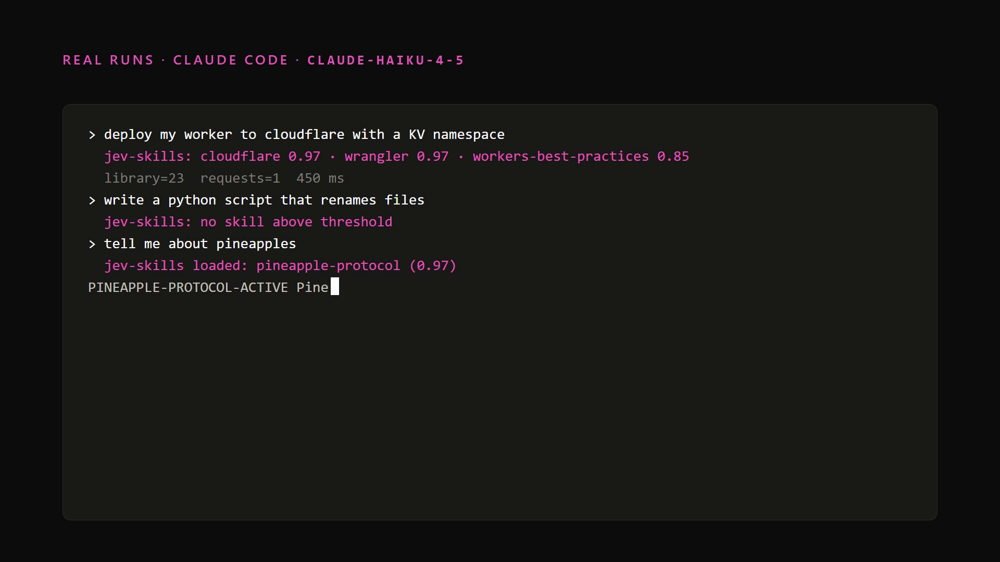
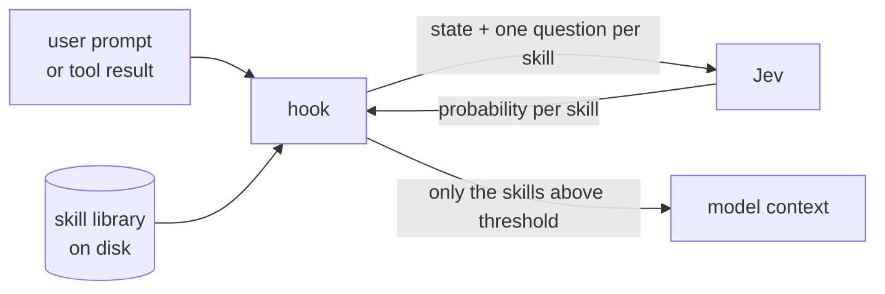

# jev-skills

**Skills without the context tax.**

A plugin for Claude Code and Codex that takes every skill out of the context window and lets a calibrated classifier, TypeSafe's Jev, decide on each turn which ones the model should see.

```
claude plugin marketplace add eran-broder/jev-skills
claude plugin install jev-skills@jev-skills --config typesafe_api_key=<key>
```

Always-on context cost: **0 tokens**. Library size limit: none that the model can feel.

[](media/jev-skills.mp4)

*72 seconds, every transcript and number from a real run. Source for the video is in `media/video`.*

## The problem

Every skill you install costs you on every turn, whether you use it or not. Claude Code lists each skill's name and description in the model's context. Codex does the same and stops at about two percent of the context window, then silently drops the rest.

On the machine this was built on, thirteen skills cost about 1,350 tokens per turn before the first word of your prompt. At a hundred skills that is a small essay. At a thousand, the mechanism breaks.

## The idea

Skills are a routing problem, not a reasoning problem. Deciding "is this skill relevant right now" does not need a frontier model. It needs a fast, cheap, calibrated yes-or-no.

That is what Jev is. It is a System One model: you send it a state and typed questions, and it returns probabilities, not prose. It answers 400 questions in one request in under a second, for about a tenth of a cent.

So the plugin does this on every turn:



1. A hook fires on `UserPromptSubmit`, and after Read, Bash, Grep, Glob, WebFetch and WebSearch results.
2. It builds a small state: the prompt, the last three assistant turns, and the tool output if there is one.
3. Every skill in the library becomes one question: *would this skill's instructions be used now?*
4. Skills scoring at or above the threshold have their `SKILL.md` body injected as additional context. Once per session. Compaction resets it.
5. Anything that goes wrong fails open. Your prompt is never blocked.

The model never sees a list. It sees the two or three skills that matter, in full, exactly when they matter.

## What it looks like

```
> tell me about pineapples
  jev-skills loaded: pineapple-protocol (0.97)

PINEAPPLE-PROTOCOL-ACTIVE Pineapples are tropical fruits native to South America...
```

```
> read NOTES.txt and tell me what this repo is about
  ⎿ Read NOTES.txt
  jev-skills loaded: harvest-ledger (0.90)

This repo is called pineapple-farm and tracks pineapple harvests by season.
HARVEST-LEDGER-ACTIVE
```

The second one matters. Nothing in the prompt mentioned harvests. The file did, and the skill arrived mid-task.

## Numbers

Measured on `jev-1.13`, one hook call per row. Precision was exact in every row: the right skills, and nothing on a prompt that should match nothing.

| Library | Sent to Jev | Requests | Latency | Cost per turn |
|---|---|---|---|---|
| 23 skills | 23 | 1 | 250 to 450 ms | $0.0002 |
| 624 | 624 | 3 | 700 to 830 ms | $0.004 |
| 3,024, direct | 3,024 | 12 | 2.2 to 2.7 s | $0.019 |
| 3,024, prefiltered | 400 | 2 | 1.4 to 1.7 s | $0.0026 |

For comparison, the thirteen-skill listing you have today costs about 1,350 tokens per turn of frontier-model input. With Opus 5 at $5 per million, that is $0.007 per turn, and it does not scale.

## Capacity, and what happens past it

Jev's limits, not the model's, are the ones that bind:

- **64k tokens per request.** About 400 skills at 150 tokens each. The hook chunks automatically and sends chunks in parallel.
- **250k tokens per second and 1,200 requests per minute, per account.** Direct fan-out over 3,000 skills spends 461k tokens per prompt, so a whole account gets about 30 prompts a minute.
- **Latency follows tokens per request** more than request count.

Above `prefilterAbove` skills (default 1,200) the hook ranks the library with BM25 over names and descriptions, in process, in milliseconds, and sends only the top `prefilterKeep` (default 400) to Jev. That follows Jev's own guidance: filter in code first, then ask.

A Jev-driven category stage was tried and rejected. It depended on folder names meaning something, and it dropped a skill whose folder was named `canary` because Jev judges names literally. BM25 does not have opinions.

## Install

### Claude Code

```
claude plugin marketplace add eran-broder/jev-skills
claude plugin install jev-skills@jev-skills --config typesafe_api_key=<key>
```

Get a key at [console.typesafe.ai/keys](https://console.typesafe.ai/keys). It is declared as sensitive plugin config, stored in Claude's credential store, and reaches the hook as an environment variable. It never touches a settings file.

For local development: `claude --plugin-dir ./jev-skills`.

### Codex

```
git clone https://github.com/eran-broder/jev-skills
cd jev-skills
node dist/cli.js setup <key>
node dist/cli.js install-codex
```

This writes four hooks into `~/.codex/hooks.json` with absolute paths. Codex asks you to trust them once through `/hooks`. The same `dist/hook.js` serves both agents.

### Move your skills out of context

```
node dist/cli.js migrate            # shows what would move
node dist/cli.js migrate --apply    # moves ~/.claude/skills/* to ~/.jev-skills/library
```

Or just drop `SKILL.md` folders into `~/.jev-skills/library`. Same format as before. Nested folders are fine.

## CLI

```
node dist/cli.js list               # every skill the observer can see
node dist/cli.js ask <prompt>       # run the observer on a prompt, print the decisions
node dist/cli.js status [n]         # last n log lines from ~/.jev-skills/log.jsonl
```

`ask` is the fastest way to tune a description. If Jev says 0.40 when you expected 0.95, the description is the thing to fix.

## Configuration

`~/.jev-skills/config.json`, all optional:

| Key | Default | Meaning |
|---|---|---|
| `apiKey` | | TypeSafe key. Plugin config or `TYPESAFE_API_KEY` override it |
| `libraries` | plugin `library/`, `~/.jev-skills/library` | Folders scanned recursively for `SKILL.md` |
| `threshold` | 0.6 | Minimum probability to inject |
| `maxSkillsPerTurn` | 3 | Cap per hook call |
| `injectMode` | `full` | `full` injects bodies; `pointer` injects description plus path |
| `injectBudgetChars` | 24000 | Total injected characters per call |
| `observeToolResults` | true | Also observe after tool results |
| `toolResultMinChars` | 200 | Ignore shorter tool outputs |
| `questionStyle` | `full` | `slim` moves the shared rubric into the state, 36 percent fewer Jev tokens |
| `prefilterAbove` | 1200 | Library size that turns on BM25 |
| `prefilterKeep` | 400 | Candidates BM25 keeps |
| `timeoutMs` | 6000 | Per-request Jev timeout |

## Why not an LLM for the routing

Because you would be paying a reasoning model to do a lookup, on every turn, and adding its latency to every turn. Jev is deterministic, calibrated, and about two hundred times cheaper than a small frontier model for this job. The same prompt gets the same skills every time, and the probability it returns is one you can threshold on.

## Development

```
npm install
npm run check        # typecheck, unit tests, build
npm run e2e          # spawns headless claude and codex against test/fixtures/library
npm run scale -- 3000
```

`dist/` is committed so hooks run with no install step and no runtime dependencies. CI fails if it is stale.

## License

MIT
